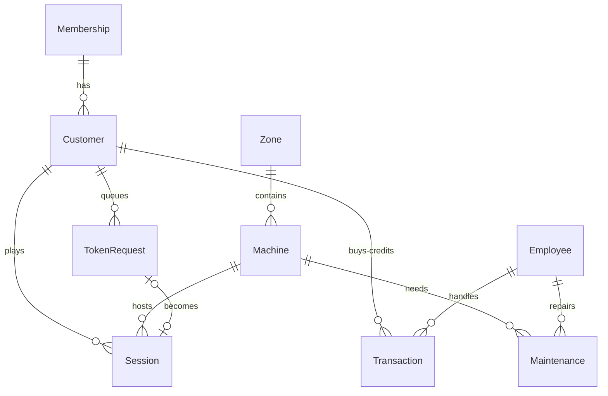

# Arcade Management System

A full-stack staff console for running an arcade: machines grouped into zones, a priority queue of players waiting for a token, play sessions with credits and an undo stack, customer memberships, maintenance tickets, role-based logins and eight live reports.

It started as two separate university projects, a **C++ Data Structures console app** and an **SQL Server database design**, and this repository joins them into one application: a web UI, a REST API, a real database, and the original data structures running in the middle.


## What it does

- **Zones and machines.** Zones live in a linked list. Each zone keeps its machines in a self-balancing binary search tree keyed by machine ID. The UI can draw the tree for any zone.
- **Token queue.** Players join a two-level priority queue. Gold and Platinum members (or tournament entries) are served first; inside each level it is first come, first served. A request that cannot get a machine stays queued instead of blocking everyone else.
- **Sessions with undo.** Starting a session charges credits (with the member discount), marks the machine *In Use* and pushes the session onto a stack. Rolling back pops the newest session, refunds the credits and frees the machine.
- **Customers and credits.** Register players, sell credits (Rs 2 = 1 credit), earn reward points, apply membership discounts.
- **Maintenance.** Opening a ticket takes a machine out of play. Resolving the last open ticket puts it back.
- **Roles.** Manager, Cashier, Technician and Security each see and can do different things. The server enforces it, not just the menu.
- **Reports.** The eight analysis queries from the database project, parameterised and exportable as CSV.

| Machines, with the tree view | Token queue |
|---|---|
|  |  |

## How the data structures are used

The database is the source of truth. At startup the server loads it into the structures below, and every write updates both, so the structures are the working copy used to answer questions quickly.

| Structure | C++ prototype | Where it lives now | What it does |
|---|---|---|---|
| Linked list | `Zone` list | `server/dsa/ZoneList.js` | Ordered list of zones; each node owns a machine tree |
| Binary search tree | `Machine` BST | `server/dsa/MachineTree.js` | Machines per zone, in-order listing, first-available lookup, status counts. Upgraded to an **AVL tree**, because auto-incrementing IDs turn a plain BST into a linked list |
| Queue (linked list) | `TokenRequestQueue` | `server/dsa/PriorityTokenQueue.js` | Two FIFO queues, high before normal |
| Stack (linked list) | `SessionStack` | `server/dsa/SessionStack.js` | Session history and rollback |

`server/dsa/ArcadeEngine.js` ties them together, and `server/services/arcadeService.js` holds the business rules.

## Tech stack

Node.js 20+ · Express · SQLite (`better-sqlite3`) · JWT in an httpOnly cookie · bcrypt · Helmet · vanilla JavaScript front end (no build step) · `node:test` for tests.

## Getting started

```bash
git clone <your-repo-url>
cd arcade-management-system
npm install
cp .env.example .env       # optional in development
npm start
```

Open <http://localhost:3000>. The first start creates `data/arcade.db` and fills it with demo data.

| Username | Role | Can do |
|---|---|---|
| `manager` | Manager | Everything, including zones, machines, staff, reports and session rollback |
| `cashier` | Cashier | Customers, top-ups, token queue, sessions. Cannot edit machines |
| `technician` | Technician | Maintenance tickets and machine status |
| `security` | Security | Read-only views |

The demo password is `arcade123` (change it with `DEMO_PASSWORD` in `.env`). **Change the passwords from the Staff page, or set `SEED_DEMO_DATA=false` and create your own accounts, before putting this anywhere other than your own machine.** In production (`NODE_ENV=production`) a `JWT_SECRET` is required.

Other commands: `npm run dev` (auto-restart), `npm run db:reset` (rebuild the database with fresh demo data), `npm test`.

## Tests

```bash
npm test
```

16 tests cover the four data structures (ordering, balancing, priority, LIFO) and the API end to end: login, role restrictions, priority serving, one-session-per-machine, insufficient credits, rollback refunds, top-ups, maintenance locking and report/CSV output.

## API overview

All routes are under `/api` and need a session cookie (or `Authorization: Bearer <token>`) except `POST /auth/login`.

| Area | Endpoints |
|---|---|
| Auth | `POST /auth/login` · `POST /auth/logout` · `GET /auth/me` · `POST /auth/change-password` |
| Floor | `GET /dashboard` · `GET/POST /zones` · `GET /zones/:id/tree` · `GET/POST /machines` · `PATCH /machines/:id` · `GET /games` |
| Queue | `GET /tokens/queue` · `POST /tokens` · `DELETE /tokens/:id` · `POST /tokens/process-next` · `POST /tokens/process-all` |
| Sessions | `GET /sessions` · `GET /sessions/stack` · `POST /sessions` · `POST /sessions/:id/end` · `POST /sessions/rollback` |
| Customers | `GET/POST /customers` · `GET /customers/:id` · `POST /customers/:id/topup` · `GET /transactions` |
| Maintenance | `GET/POST /maintenance` · `PATCH /maintenance/:id` |
| Staff | `GET/POST /employees` · `GET /technicians` |
| Reports | `GET /reports` · `GET /reports/:key` (add `?format=csv`) |

## Database



The schema is in `server/db/schema.sql`. Compared with the original SQL Server design it adds `Zone`, `TokenRequest`, session status and planned minutes, machine token type, and employee logins; `Machine.Location` became a real `Zone` relationship; credit balances are whole numbers. The original script and ERD files are kept in `database/sqlserver/` and `docs/original-design/`.

## Project structure

```
client/            Front end: index.html, css/, js/ (router, API client, one file per page)
server/
  dsa/             AVL tree, linked list, priority queue, stack, engine
  services/        Business rules, pricing, reports
  routes/          REST API and role checks
  db/              Schema, demo data, init script
  tests/           Data-structure and API tests
database/sqlserver/  Original SQL Server script from the database project
legacy-cpp/        Original C++ console prototype
docs/              Screenshots and the original ERD files
```

## Design notes and limits

- **Single process.** The in-memory structures assume one server process. Running several copies against the same database would let their copies drift apart.
- **SQLite.** Chosen so the project runs with one command. The original SQL Server script is included if you want to port the data layer.
- **Credits** are charged when a session starts and are not partly refunded if it ends early. Only the manager's rollback refunds.
- **Pricing.** `CreditCost` is credits per 5-minute block; the membership discount applies to the total.

## Ideas for next steps

Live updates over WebSockets, a customer-facing queue screen, per-branch support (the report calls for it), Docker packaging, and a PostgreSQL or SQL Server data layer.

## Credits

Database design (ER diagram, relational schema and SQL Server script) from the Database Lab project by Muhammad Hamza Gulzar. Data-structure prototype in C++ and full-stack integration by Jabran.
Pixel font: [Press Start 2P](https://fonts.google.com/specimen/Press+Start+2P) by CodeMan38 (SIL Open Font License, see `client/fonts/`).

## License

MIT, see [LICENSE](LICENSE).
